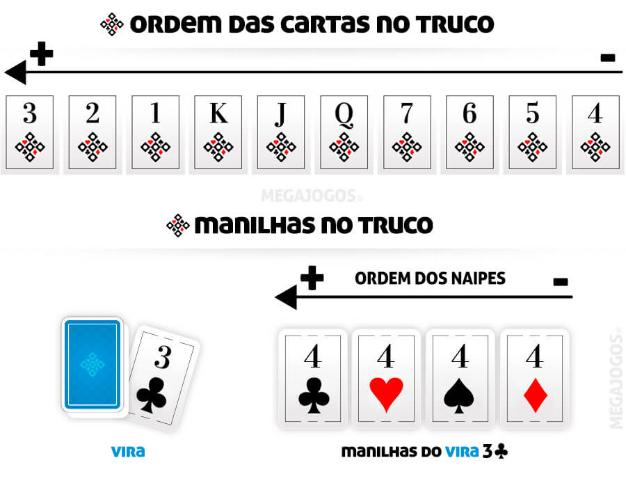

# Truco — Tournament Simulator

A tournament simulator for **Truco**, a traditional Brazilian card game, developed in Python as **Project 2 for MC102 — Algorithms and Computer Programming**, at the University of Campinas (Unicamp).

The project implements matches between pairs of players using different strategies, a scoring system, and a graphical interface built with Pygame.

## Authors

- **Nicolas Pavanetti** [GitHub](https://github.com/nicolaspavanetti)
- **Bruno Alvim Cravo** [GitHub](https://github.com/yorb0)

Developed as a pair programming project for the MC102 course.

## About the Project

This simulator allows different player pairs to compete in Truco matches in a round-robin tournament format. Each player follows a strategy to choose which cards to play, decide when to call Truco, and respond to opponents' bets.

In addition to the game logic, the project features a graphical interface that displays played cards, player information, scores, and match results.

## Features

- **Multiple player strategies:** random, greedy, and cautious strategies, alongside the strategy developed by the authors.
- **Scoring system:** tracks hand, game, and match scores.
- **Truco betting system:** supports decisions to fold, accept, or raise a bet.
- **Move history:** records actions performed during matches.
- **Graphical interface:** displays cards, players, scores, and results using Pygame.
- **Automated tournaments:** runs matches between different player pairs and organizes the results.
- **Configurable execution speed:** allows animations to be sped up or the simulator to run without the graphical interface.

## Demo

The image below illustrates a Truco hand in the simulator.



## Player Strategies

The project includes several approaches to decision-making:

| Player | Strategy |
|---|---|
| `DummyPlayer` | Randomly selects valid cards and never calls Truco. |
| `GreedyPlayer` | Prioritizes the strongest available card and may call or raise Truco when holding a strong card. |
| `ReverseGreedyPlayer` | Attempts to save strong cards for later rounds, taking the current state of the hand into account. |
| `BobbyFischer` | A custom strategy developed by the authors that considers available cards, previous plays, teammates' decisions, opponents' cards, and Truco betting conditions. |

The `BobbyFischer` strategy is implemented in `student_players.py`. It attempts to conserve strong cards when a teammate is already winning a round and uses stronger cards when necessary to try to turn an unfavorable situation around.

## Project Structure

```text
truco-tournament/
├── basic_players.py
├── drawer.py
├── judge.py
├── main.py
├── student_players.py
├── tournament.py
├── exemplo-truco.png
├── fonts/
│   └── ...
├── img/
│   └── ...
└── README.md
```

### Main Files

- `main.py`: entry point for running the simulator.
- `basic_players.py`: defines the base player class and the built-in player strategies.
- `student_players.py`: implements the custom strategy developed by the authors and the functions required to create their player pair.
- `judge.py`: contains functions related to card evaluation and game rules.
- `drawer.py`: implements the graphical interface and rendering functions using Pygame.
- `tournament.py`: manages tournament execution and result tracking.
- `fonts/`: contains font files used by the graphical interface.
- `img/`: contains images and visual assets used by the project.
- `exemplo-truco.png`: demonstration image displayed in this documentation.

## Technologies

- **Python** — game logic, player strategies, and tournament simulation.
- **Pygame** — graphical interface and match visualization.
- **Git and GitHub** — version control and source code hosting.

## Getting Started

### Prerequisites

- Python 3.7 or later.
- Pygame for the graphical interface.

### 1. Clone the Repository

```bash
git clone https://github.com/SEU-USUARIO/truco-tournament.git
cd truco-tournament
```

Replace `SEU-USUARIO` with your GitHub username and adjust the repository name if necessary.

### 2. Create and Activate a Virtual Environment

```bash
python3 -m venv .venv
source .venv/bin/activate
```

On Windows, activate the environment with:

```powershell
.venv\Scripts\activate
```

### 3. Install Dependencies

```bash
pip install pygame
```

### 4. Run the Simulator

To start the graphical interface:

```bash
python3 main.py
```

To run the simulator without the graphical interface:

```bash
python3 main.py --speed 0
```

## Command-Line Arguments

The program supports configuration of the number of matches and the animation speed.

| Argument | Description |
|---|---|
| `-n`, `--num-matches` | Sets the number of hands played in a match between two pairs. Default: `1000`. |
| `-s`, `--speed` | Sets the animation speed. Default: `1`. A value of `0` disables graphical visualization. |

Examples:

```bash
# Run with 500 hands per match
python3 main.py --num-matches 500

# Run at twice the normal speed
python3 main.py --speed 2

# Run 100 hands per match without graphical visualization
python3 main.py -n 100 -s 0
```

## Academic Objectives

The development of this project involved several programming concepts and software design practices, including:

- Object-oriented programming and inheritance.
- Implementation and comparison of decision-making strategies.
- Modular code organization.
- Manipulation of data structures and match histories.
- Graphical interface development.
- Automated match simulation and result analysis.

## Academic Context

This project was developed in pairs as part of **MC102 — Algorithms and Computer Programming**, at the **University of Campinas (Unicamp)**.

The simulator combines the implementation of game rules, the development of player strategies, and tournament execution, applying programming concepts studied throughout the course.
